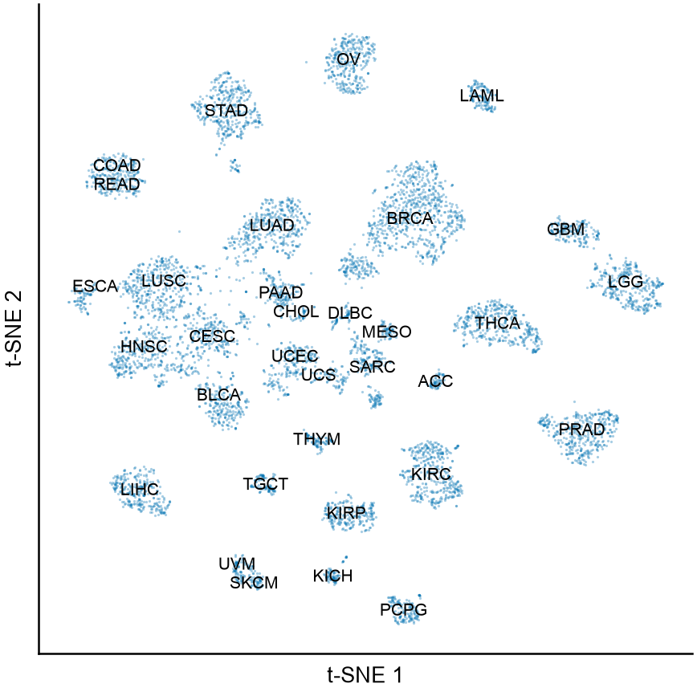

# lncrna-pancancer-classifier

[](https://github.com/MMatinGerami/lncrna-pancancer-classifier/actions/workflows/ci.yml)
[](LICENSE)
[](https://github.com/MMatinGerami/lncrna-pancancer-classifier/releases)
<!-- add the Zenodo DOI badge once the repo is archived (see notes) -->

Can long non-coding RNAs alone tell which tissue a tumour came from?

**In one line:** logistic regression on 2,000 lncRNAs assigns 33 TCGA cancer types with macro-F1
0.946 (95% CI 0.928 to 0.959) and top-3 accuracy 0.996 on 1,868 held-out tumours; 500 lncRNAs are
enough; protein-coding genes do no better; and a conformal set with a stated error rate comes with
every prediction (`lncpan predict`).

The motivation is cancer of unknown primary, and the fact that lncRNAs are more tissue-specific
than most protein-coding genes ([Yan et al., 2015](https://doi.org/10.1016/j.ccell.2015.09.006)).
Trained on the lncRNA expression of 9,337 TCGA tumours from 33 cancer types, compared with the
same models on protein-coding genes.

<p align="center"></p>

*lncRNA expression alone separates the 33 cancer types. t-SNE of the 7,469 training tumours on
their 2,000 most variable lncRNAs; each label sits at the median position of its cancer type.*

## Results at a glance

| Question | Answer |
|---|---|
| How accurate? | Macro-F1 0.946 (95% CI 0.928 to 0.959), accuracy 0.966, top-3 accuracy 0.996 on 1,868 held-out tumours, 33 classes |
| lncRNAs or protein-coding genes? | lncRNA models are at least as accurate for all three classifiers (delta macro-F1 +0.010 to +0.017; significant for one of three) |
| How many lncRNAs? | 500 reach cross-validated macro-F1 0.946, against 0.924 for 500 protein-coding genes |
| Where are the errors? | Between related cancers: rectum and colon, oesophagus and stomach, cholangiocarcinoma and pancreas |
| Does it hold on metastases? | Trained on primaries only, 93% of 364 melanoma metastases from unseen patients are assigned to skin (top-3: 97%) |
| Unseen hospitals? | Every tissue source site held out: macro-F1 0.938 to 0.895, the same cost as for protein-coding genes |
| External cohort? | MET500 (437 biopsies, another centre and pipeline): only the protein-coding model can be tested (the public matrix has no lncRNAs): 66% top-1, 82% top-3, over-confident |
| Are the probabilities usable? | ECE about 0.01 on the TCGA test split, 0.126 on MET500; conformal sets at 90% cover 76% of external metastases with one global threshold and 94% with the randomised adaptive score |
| Is the biology sensible? | SHAP recovers known tissue-restricted lncRNAs: LINC00518 (melanoma), PTCSC3 and NKX2-1-AS1 (thyroid) |

Figures and tables for every analysis are in [docs/results.md](docs/results.md); the model is
described in [MODEL_CARD.md](MODEL_CARD.md).

## Quickstart

```bash
uv sync
make data    # TCGA from UCSC Xena and GENCODE v23, about 750 MB
make all     # every analysis and figure
make test
```

Predict new samples (log2(TPM + 1) lncRNA expression, GENCODE v23 gene ids) with a 90% conformal
set:

```bash
uv run lncpan predict new_samples.parquet --alpha 0.1
```

The trained model (`results/models/lncRNA__logreg_conformal.joblib`) is produced by `make all`;
the conformal thresholds (`results/models/lncRNA__conformal_thresholds.json`) are in the
repository.

## When to use this

- You have bulk RNA-seq of a tumour of unknown or uncertain primary and want a tissue-of-origin
  call with a prediction set rather than a single over-confident label.
- You want a reproducible pan-cancer benchmark of lncRNA against protein-coding features with
  patient-level splits, site hold-outs and an external cohort, as a baseline for your own method.
- You design a small lncRNA panel: the feature-budget analysis says what 100, 500 and 2,000
  genes buy.

Not a clinical tool (see the model card), and not validated on a cancer-of-unknown-primary
cohort quantified with lncRNAs (issue #1).

## Limitations

- All tumours come from TCGA, so centre and batch effects may inflate performance.
- The metastasis result covers one cancer type (melanoma).
- Bulk tissue: part of the signal comes from stroma and immune cells, not the tumour.
- SHAP ranks what the model uses; it does not show a functional role.

## Citation

```bibtex
@software{gerami2026lncpan,
  author  = {Gerami, Matin},
  title   = {lncRNA-only pan-cancer tissue-of-origin classification},
  year    = {2026},
  version = {0.5.0},
  url     = {https://github.com/MMatinGerami/lncrna-pancancer-classifier}
}
```

## Data

TCGA expression re-processed with Toil ([Vivian et al., 2017](https://doi.org/10.1038/nbt.3772)),
from UCSC Xena ([Goldman et al., 2020](https://doi.org/10.1038/s41587-020-0546-8)); clinical labels
from [Liu et al., 2018](https://doi.org/10.1016/j.cell.2018.02.052); annotation GENCODE v23. The
results are based upon data generated by the TCGA Research Network: https://www.cancer.gov/tcga.

## License

MIT
